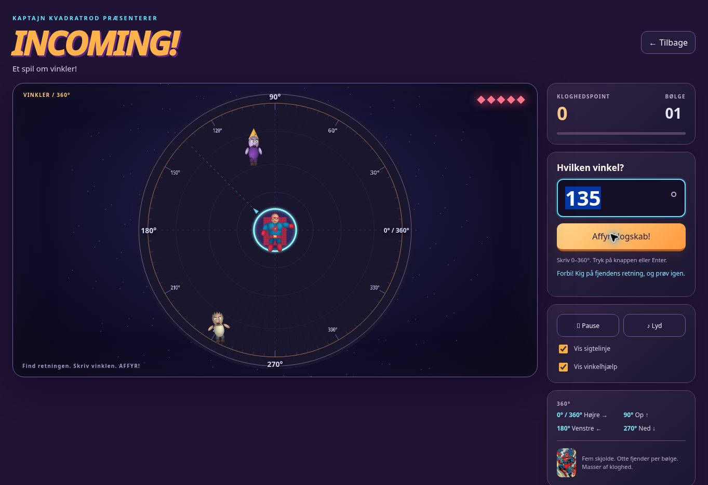

# Incoming! Et spil om vinkler!

Incoming is a profile-gated beta game. Kaptajn Kvadratrod stands in the centre of a 3D arena. Dummerter, Erlinger, papers marked “DUMPET”, spitballs and remoulade sandwiches fly towards him. Enter an angle from 0 to 360, then click **Affyr klogskab!** or press Enter to fire a mathematical symbol.

| Angle | Screen direction |
| --- | --- |
| 0° / 360° | Right |
| 90° | Up |
| 180° | Left |
| 270° | Down |

The camera uses equal horizontal and vertical scale, preserving these directions on both desktop and mobile. Swept segment collision checks prevent fast shots from passing through enemies. Only the first intercepted enemy scores a hit. Five shields, eight incoming enemies per wave, three difficulty settings, pause/resume, replay and optional aiming/angle guides are included.

## Visibility and navigation

`canPlayIncoming` uses the existing `ANGLES_PROFILE_IDS` allowlist for Jacob’s teacher and student profiles, with a teacher/student role check. It rejects guests, all other profiles and “Se som elev”. Visibility, click handling and mount-after-loading each check this condition, including an identity check after asynchronous loading.

- Teacher profile: Sandbox → Incoming, or the Front-end practice shortcuts.
- Student profile: Andre genveje → Incoming.
- `?start=incoming` uses the same gated shortcut; it does not grant access to other profiles.
- Back returns to Sandbox when launched there, otherwise to the current profile’s home screen.

The game does not create users or save practice results. Existing Vinkler/Skak availability and backend permissions are unchanged.

## Animation and sound

`incoming.js` builds animated 3D meshes with the existing local Three.js r158 library: blue suit, red mask and moving cape, square-root chest emblem, arm movement, recoil, tumbling enemies and hit particles. Portrait references continue using the existing character gallery assets.

Eight authored Danish MP3 files are included, so the device’s browser language cannot select an English voice for Danish text:

1. Tag dén, dummert!
2. Lad klogheden sejre!
3. Æd mit sigma!
4. Plus på dig, Erling!
5. Gå hjem og læs!
6. Smag på mit gangetegn!
7. Jeg brøk'er dig midt over!
8. Kom nærmere - matematik-tæsk på tilbud!

Speech uses Danish JeppeNeural, lowered in pitch and processed with EQ/compression. `scripts/generate_incoming_audio.py` regenerates these clips using `edge-tts` and FFmpeg. Repeated shots do not queue a backlog of voices. Pause, mute, navigation and teardown stop playback. English UI/captions are provided; the authored voice clips are Danish and are played only in the Danish UI.

WebGL is the default renderer. If unavailable, `incoming-renderer.js` projects the same scene and camera into Canvas2D, retaining all game mechanics. Reduced-motion settings reduce ambient movement and particle counts. Hiding the tab pauses the game. Navigation disposes graphics, observers, audio and animation frames.



## Verification

Run from the repository root:

```sh
node scripts/test-incoming-core.cjs
node scripts/test-incoming-gating.cjs
node scripts/test-lazy-load-startup.cjs
node scripts/test-student-view.cjs
```

Core checks cover cardinal and arbitrary angles, 0/360 equivalence, invalid input, misses, nearest-target swept collisions, cooldown, pause, all five enemy types, wave completion and game over. Access checks cover both Jacob profiles, other student/teacher/guest profiles, student preview, identity changes during loading, teardown and all eight MP3s.

Manual browser QA covers a 360° rightward hit, score, pause, language switching without resetting score/input, sandbox return, both profile entry points, hidden cards for other profiles, and a 390-pixel mobile iframe. The test browser disables WebGL, so these browser checks use the CPU fallback; the hardware WebGL rendering path still needs a device smoke test. All eight shipped MP3s decode successfully with FFmpeg.

This change is prepared as a draft pull request only; it is not merged or deployed.
